<div align="center">

# Dolphin Rt:Stream

**Stream GameCube & Wii games from your PC to a muOS handheld.**

Sunshine + Moonlight, wrapped in a GameCube-style 2.5D frontend, with editable controller profiles and one-tap library sync.

[](https://github.com/SilverCrow2323/dolphin-rt-stream/releases/latest)
[](https://muos.dev)
[](LICENSE)

</div>

---

> **TL;DR** — Dolphin runs on your PC. The handheld is the TV. Moonlight is the wire. This repo is the frontend that makes it feel like a real console. Part of the **[Dolphin Rt:Core for muOS](https://github.com/SilverCrow2323/Dolphin-Rt-Core)** ecosystem.

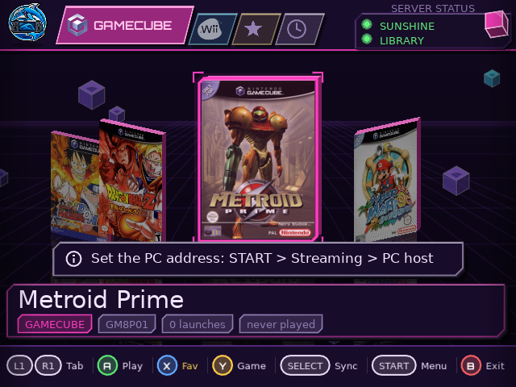

<details open>
<summary><b>What's new in 4.1.0</b></summary>

**Handheld**
- Uses muOS Moonlight (`/opt/muos/share/application/Moonlight/`) for `love`, `libs/`, `moonlight/`, `keys/` — fallback to bundled copies if not installed
- `gptokeyb2` stays bundled (it is not part of muOS Moonlight)
- New `tools/paths.sh` — one file to update if muOS changes paths

**PC portal**
- `spdw-stream preflight` — 8 checks, exit 1 on critical failure
- `spdw-stream cleanup covers` — remove orphan cover PNGs
- `spdw-stream config export|import` — backup/restore `config.json`
- `server_start()` prechecks the port and waits for bind
- `install_dolphin_profiles()` refuses if Dolphin is running
- Fix residual Italian string in system checks

**Carried from 3.5.0**
- SERVER STATUS panel (SUNSHINE + LIBRARY LEDs, 15 s refresh)
- Pre-flight ping: pressing **A** on a game checks the PC first
- Guide panel (**M** on any item, with ✓ recommended / ▲ warning)
- Search across the current tab
- gameMenu hero: cover 2.5D + PLAY + FAV / INFO
- Colored icons, uppercase section titles, tab icons in Controls

</details>

---

## What it is / What it's not

**It is** — a handheld app (LÖVE, 2.5D GameCube UI) that streams from Sunshine, plus a PC portal (Python/Tk) that scans your ROMs, registers them in Sunshine, serves the library over HTTP, and lets you edit Dolphin's controller mapping from the handheld itself.

**It's not** — an emulator. The handheld never decodes a GameCube frame. The PC does all the rendering; Moonlight streams the video + virtual Xbox pad.

```text
PC (Linux, X11)                      Handheld (muOS)
────────────────────                 ─────────────────────
Dolphin ──render──▶ Sunshine ──▶ Moonlight ──▶ screen
Sunshine :47989 ──H.264/H.265─▶ Moonlight ──▶ pad
Library :8765   ──library.tsv─▶ Dolphin Rt:Stream
Profiles ◀──── /ctl ──── edit mapping
```

---

## What's inside

### Handheld (`muos/Dolphin RtStream/`)

| Feature | Notes |
|---|---|
| **Cover Flow / Grid / List library** | GameCube, Wii, Favorites tabs (Recent merged into Favorites) |
| **Boot animation** | 120-frame sprite sheet, "Dolphin Rt:Core" logo with electric flicker |
| **SERVER STATUS panel** | SUNSHINE + LIBRARY LEDs, refreshed every 15s |
| **Pre-flight ping** | `A` on a game → checks PC first, clear error if off |
| **Guide panel (M)** | Short intro + per-value descriptions, ✓ recommended, ▲ warning |
| **Controls screen** | Virtual pad drawn on screen, edit bindings with `◀`/`▶`, `Y` to switch profile |
| **Search** | Filter current tab by title or app name |
| **5 themes · touch-free** | `START` ▸ Interface |

### PC (`pc/`)

| Feature | Notes |
|---|---|
| **ROM scan on every start** | Keeps `library.tsv` + Sunshine `apps.json` fresh |
| **Cover art auto-download** | GameTDB, or `<rom>.png` next to the ROM |
| **Dolphin fullscreen** | No main window, no desktop visible, panel hidden |
| **4:3 during stream** | `xrandr`, restored automatically (X11 only) |
| **Controller profile manager** | GCPad / Wiimote / Hotkeys families, applied before each launch |
| **Library server** | `:8765` + `/profiles.tsv` + `/ctl` (token-protected) |
| **Autostart** | Sunshine, server, portal, optional LightDM autologin |

---

## Quick start

### Requirements

| Environment | Requirements |
|---|---|
| **PC** | Linux **X11** (XFCE / MX Linux tested), Python ≥ 3.9 + Tk, [Dolphin](https://dolphin-emu.org), [Sunshine](https://github.com/LizardByte/Sunshine) |
| **Handheld** | muOS with LÖVE + Moonlight, or the `.muxapp` full bundle |
| **Network** | LAN, or Tailscale / WireGuard |

### 1. PC

```bash
sudo apt install ./spdw-stream-portal_4.1.0_all.deb
spdw-stream-portal
```

1. **LIBRARY** — Add GameCube / Wii ROM folders (scanned at every start).
2. **SERVICES** — Install/start Sunshine, start the library server.
3. **SYSTEM** — Checklist should be green; install controller profiles; copy the edit token.
4. Restart Sunshine once.

### 2. Handheld

1. Copy either `DolphinStream-muOS-4.1.0.zip` or `Dolphin_RtStream-4.1.0.muxapp` to the SD card.
2. Install via muOS → Applications, or unzip to `ROMS/APPLICATIONS/` → get `Dolphin RtStream/`.
3. `START` ▸ Streaming — Set PC host + Edit token.
4. `START` ▸ Tools ▸ Pair with Sunshine — Type the PIN into Sunshine's web UI.
5. `SELECT` to sync, `A` to play.

*Leave a stream with `START` + `SELECT` + `L1` + `R1`, or the Dolphin hotkey `MODE` + `START`.*

---

## Which package?

| Package | Size | Target |
|---|---|---|
| `spdw-stream-portal_4.1.0_all.deb` | ~398 KB | PC only |
| `DolphinStream-muOS-4.1.0.zip` | ~1.5 MB | Handheld with muOS Moonlight installed |
| `Dolphin_RtStream-4.1.0.muxapp` | ~3.5 MB | Handheld without Moonlight (full bundle) |

> Both handheld packages use the same `tools/paths.sh`: if muOS provides love/moonlight/keys, the app uses them; otherwise the `.muxapp` ships its own. `gptokeyb2` is bundled in both — muOS Moonlight does not include it.

---

## Controls (handheld)

| Button | Library | Menus | Overlays |
|---|---|---|---|
| **D-pad ◀ ▶** | Prev / next cover | Change value | — |
| **D-pad ▲ ▼** | Jump 4 covers | Move | Move |
| **L1 / R1** | Switch tab | Prev / next section | — |
| **A** | Play | Confirm | Select |
| **X** | Favorite | — | — |
| **Y** | Game menu | Switch profile (Controls) | — |
| **M** | — | Guide | Guide |
| **SELECT** | Sync | — | — |
| **START** | Main menu | Close all | Close |
| **B** | Exit | Back | Back |

*Full controller mapping reference: [docs/CONTROLS.md](docs/CONTROLS.md).*

---

## Diagnostics

### PC side
```bash
spdw-stream preflight                    # 8 checks, exit 1 on critical failure
spdw-stream cleanup covers               # Remove orphan cover PNGs
spdw-stream config export ~/backup.json  # Backup config
spdw-stream config import ~/backup.json  # Restore config
spdw-stream status                       # Human-readable checks
```

### Handheld side
`START` ▸ Tools ▸ Connection test, Last stream log, Verify Sunshine apps, Measure latency, Export diagnostics.

*Something broken? Start here: [docs/TROUBLESHOOTING.md](docs/TROUBLESHOOTING.md).*

---

## Documentation

- **[docs/ARCHITECTURE.md](docs/ARCHITECTURE.md)** — How the two halves talk
- **[docs/CONTROLS.md](docs/CONTROLS.md)** — Every controller mapping, in full
- **[docs/PROTOCOL.md](docs/PROTOCOL.md)** — HTTP wire formats, token checks
- **[docs/TROUBLESHOOTING.md](docs/TROUBLESHOOTING.md)** — What to do when it doesn't work
- **[docs/DEVELOPMENT.md](docs/DEVELOPMENT.md)** — Build, test, screenshots
- **[CONTRIBUTING.md](CONTRIBUTING.md)** — How to send a pull request
- **[SECURITY.md](SECURITY.md)** — Threat model, what's protected
- **[CHANGELOG.md](CHANGELOG.md)** — Every release, in full

---

## Screenshots

### Handheld

| | | |
|:---:|:---:|:---:|
| 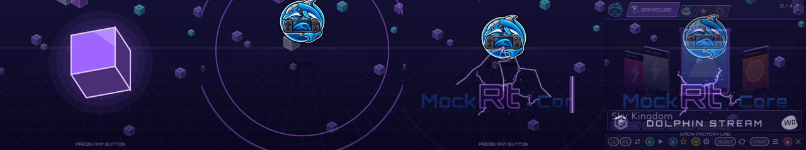 |  | 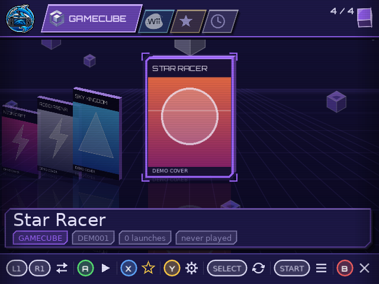 |
| 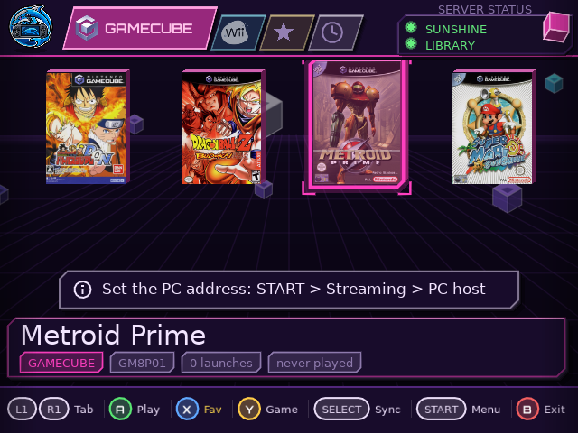 | 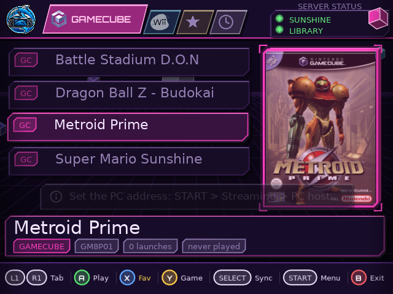 | 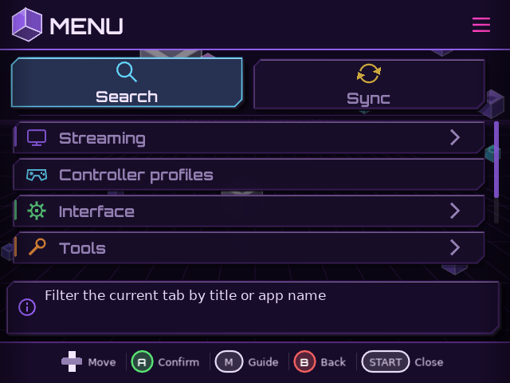 |
| 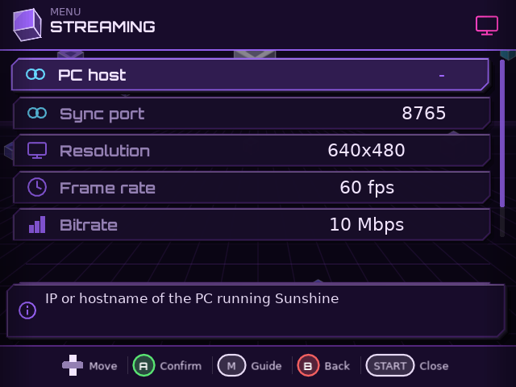 | 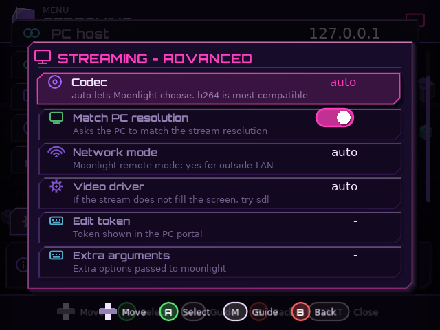 | 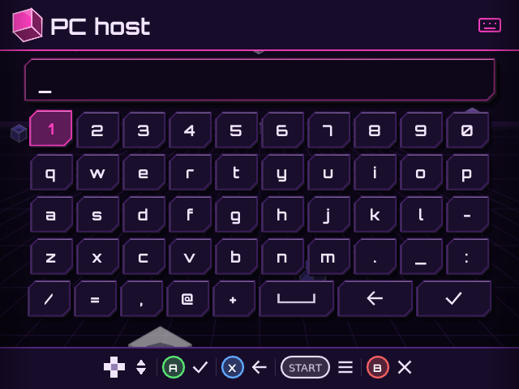 |
| 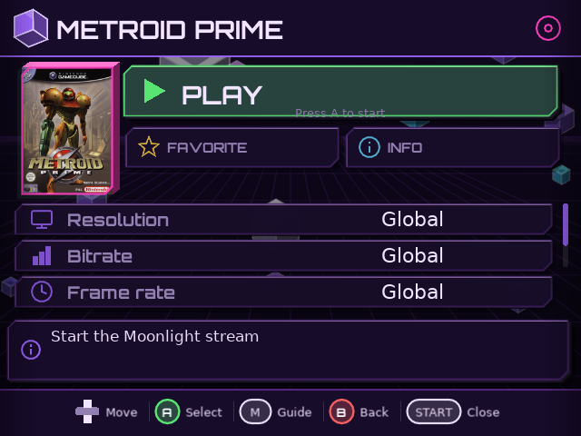 | 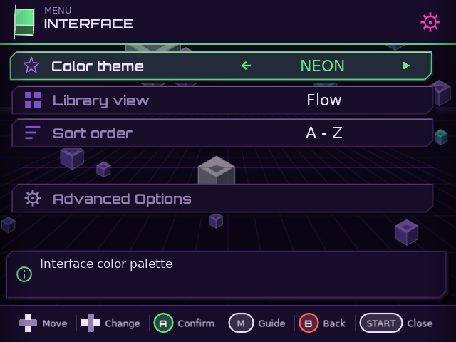 | 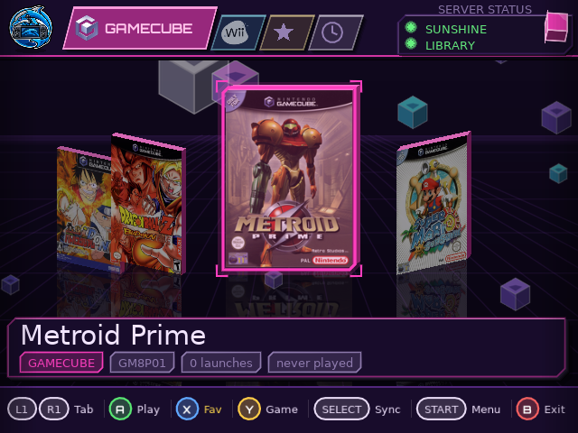 |
| 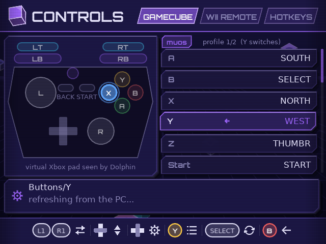 | 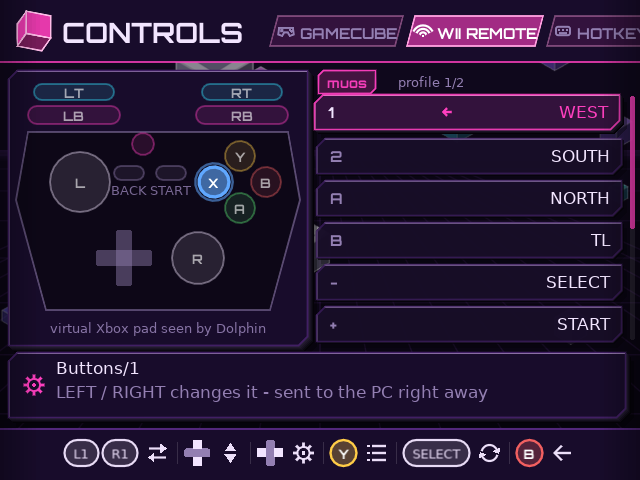 | 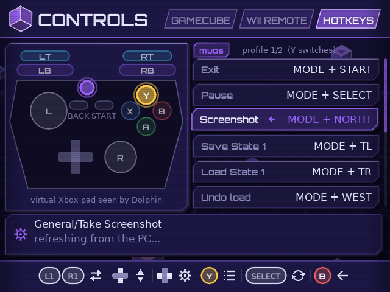 |

### PC portal

| | | |
|:---:|:---:|:---:|
| 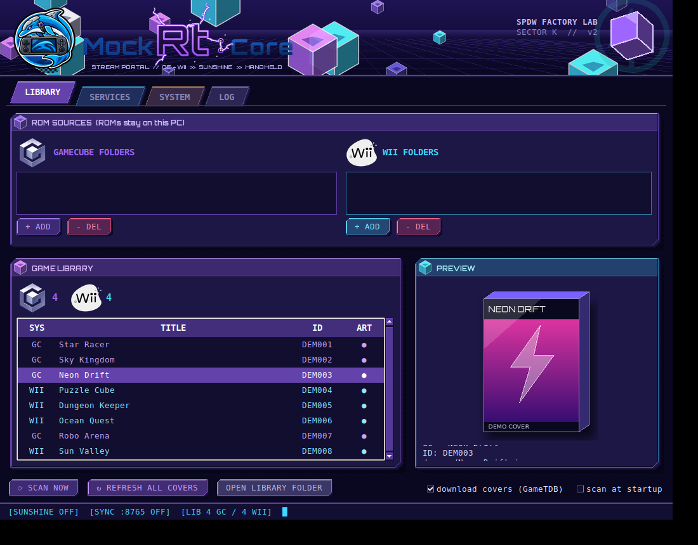 | 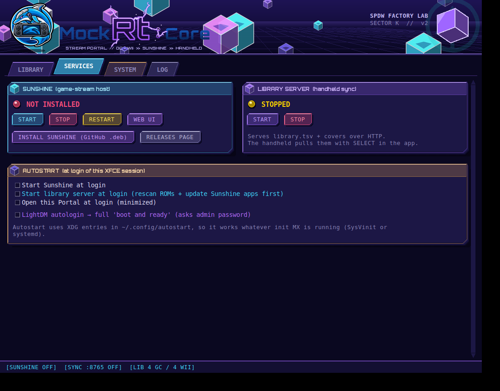 | 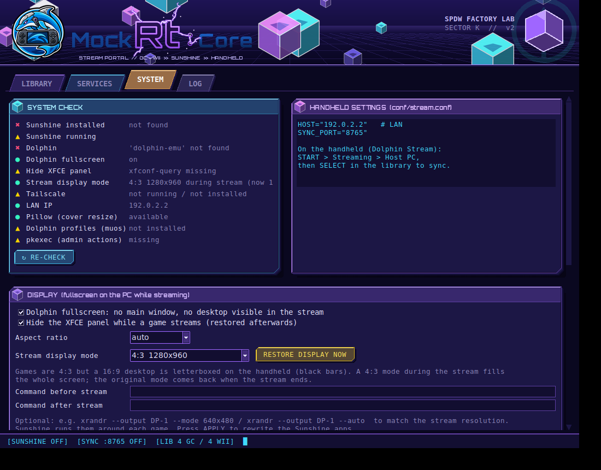 |
| 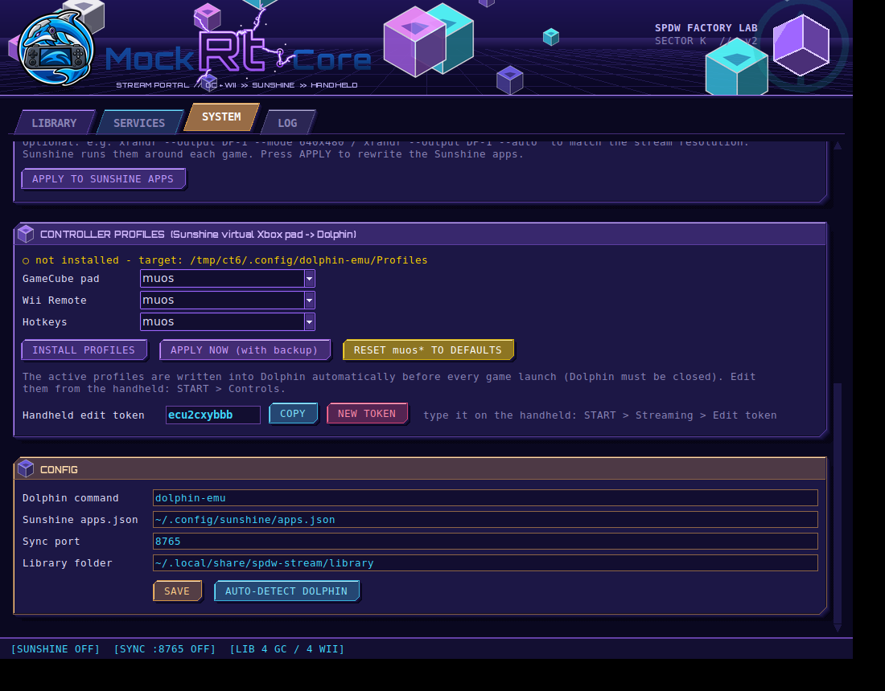 | | |

*All cover art in the screenshots is generated demo art.*

---

## Build from source

```bash
make test                                  # Python + headless Lua tests
make deb                                   # dist/spdw-stream-portal_*.deb
make muos                                  # dist/DolphinStream-muOS-*.zip
bash tools/build-muxapp.sh                 # dist/Dolphin_RtStream-*.muxapp
```

---

## Status

| Area | Verified |
|---|---|
| **PC portal, profile manager, server, token checks** | Automated tests (CI) |
| **Handheld UI, boot, Controls** | LÖVE 11.5 + headless mock fuzz |
| **Handheld → PC profile edit** | End-to-end |
| **Search, pre-flight, LEDs, guide panel** | Tested on RG35XX H |
| **Dolphin flags, hotkey names, xrandr 4:3, panel hiding, pairing** | Confirmed on real hardware (base flow) |

---

## Links

- **Dolphin Rt:Core for muOS** — The emulator side
- **GitHub repo · Releases**
- **Dolphin · Sunshine · Moonlight · LÖVE · muOS**

---

## Cover art

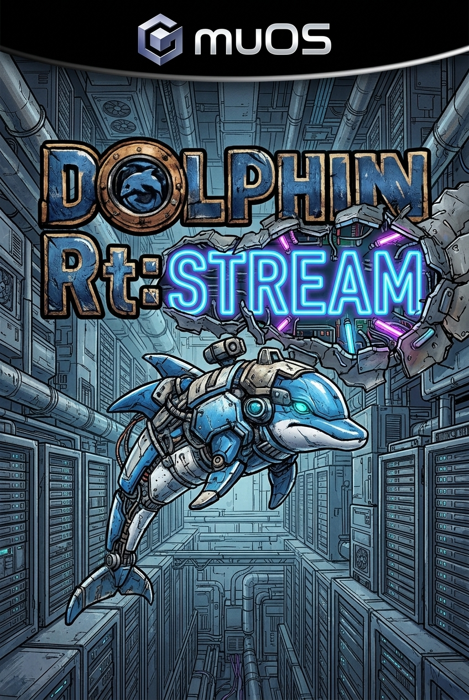

*Mock cover art for demonstration purposes. All game covers shown in screenshots are generated demo art.*

---

## License

- **Code:** MIT — see [LICENSE](LICENSE)
- **Logos (Dolphin Rt:Core, Dolphin Rt:Stream, SPDW):** © SPDW Factory Lab
- **Font:** Orbitron — SIL OFL 1.1
- GameCube and Wii are Nintendo trademarks; this project is not affiliated with or endorsed by Nintendo.
- No ROMs, BIOS or firmware included. Use your own legally obtained backups.

---

<div align="center">

**Dolphin Rt:Stream** · SPDW Factory Lab · *Streaming the Mecha-Dolphin. One handheld at a time.*

</div>